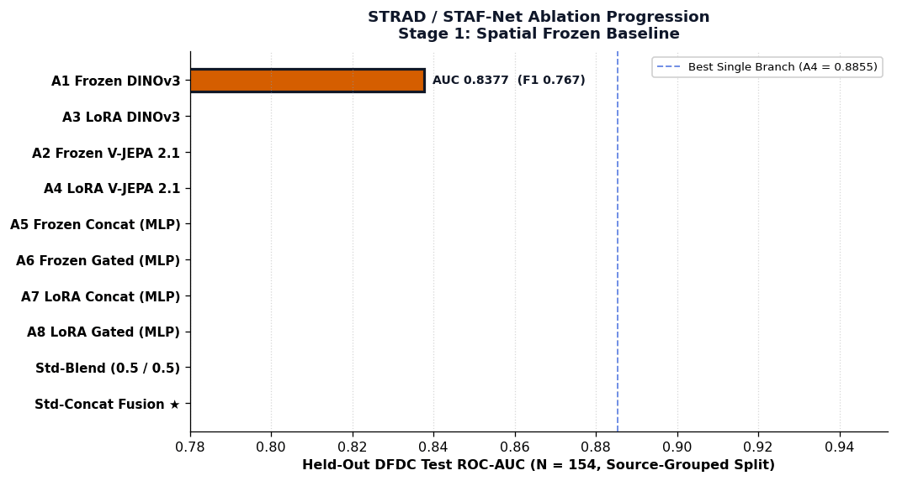
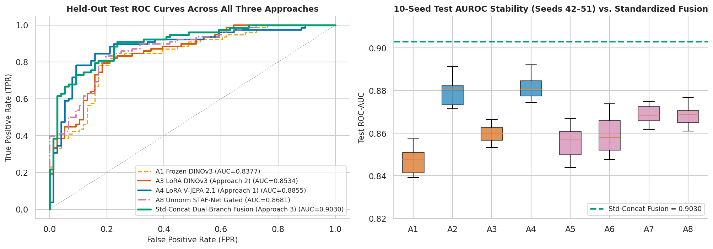
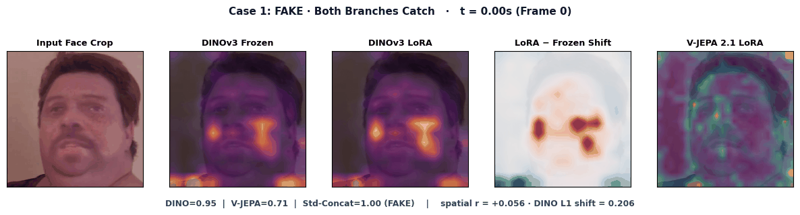
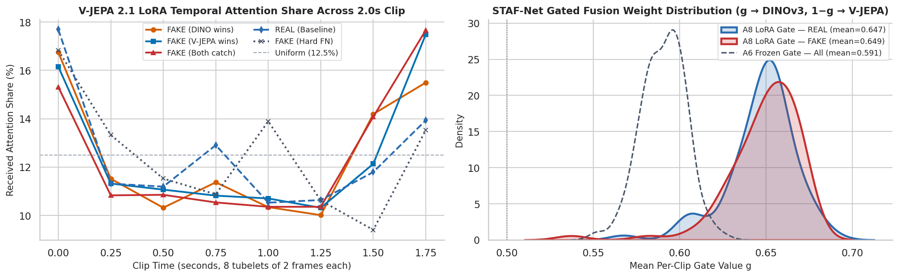

<div align="center">

# STRAD / STAF-Net: Spatial–Temporal Attention and Standardized Dual-Branch Fusion for Video Deepfake Detection

**A Reproducible Comparative Study of V-JEPA 2.1, DINOv3, and Standardized Dual-Branch Feature Fusion on DFDC**

[](https://pytorch.org/)
[](https://huggingface.co/timm/vit_small_patch16_dinov3.lvd1689m)
[](https://huggingface.co/apiantonio/vjepa2.1-vit-base-384)
[](#4-main-results--ablation-study)
[](LICENSE)

*Pengolahan Citra Digital dan Visi Komputer (CIF61339) · Universitas Brawijaya*
*Trained on 1 × NVIDIA A100-SXM4-80GB · Live Demo Deployed on NVIDIA GeForce RTX 3060 12 GB*

[Abstract](#abstract) · [Method](#2-method--architecture) · [Ablation Study](#4-main-results--ablation-study) · [Attention Maps](#5-attention-map-interpretability--gate-diagnosis) · [Live Demo](#6-live-inference-demo) · [Technical Report Notebook](notebooks/STAF_Net_Technical_Report.ipynb) · [Citation](#citation)

</div>

---

## Abstract

Video deepfake detection requires capturing both **spatial facial manipulation artifacts** (blending seams, skin texture discontinuities, mask boundaries) and **spatiotemporal inconsistencies** (identity flicker, unnatural blink dynamics, motion drift). We present **STRAD / STAF-Net**, a reproducible dual-branch video deepfake detection study combining **V-JEPA 2.1 ViT-B/16** (16-frame spatiotemporal world model) and **DINOv3 ViT-S/16** (4-frame spatial self-supervised vision encoder) under strict **source-grouped splitting** on DFDC (`1,023` verified 16-frame face clips; `716` train / `153` val / `154` test; zero `source_group_id` overlap).

Our controlled ablation study (`A1–A8` + 10-seed sweep + real post-RoPE last-block ViT attention maps) uncovers three core findings:

1. **V-JEPA 2.1 dominates as a standalone encoder:** Stage I rank-8 LoRA adaptation lifts `V-JEPA 2.1` (`A4`) to **`0.8855` Test AUROC** (`0.8462` F1; 10-seed `0.8815 ± 0.0058`), outperforming standalone `DINOv3 LoRA` (`A3`, `0.8534` Test AUROC; wins 10/10 seeds over frozen `A1`).
2. **Naive unnormalized MLP/gated fusion degrades performance:** Feeding raw unstandardized `384-d` (`DINOv3`) and `768-d` (`V-JEPA 2.1`) embeddings into a `~460K`-parameter gated MLP (`A8`) drops test AUROC to **`0.8681`** (losing 10/10 seeds to `A4`) due to cross-branch scale mismatch and small-sample gate collapse (`mean g = 0.647` on REAL vs. `0.649` on FAKE).
3. **Standardized Dual-Branch Fusion (`Std-Concat`) unlocks `+0.030` AUROC:** Despite both backbones being ViTs, their test predictions correlate only at **`r = 0.7509`** and their last-block spatial attention maps correlate at only **`r = +0.1818`**. Applying train-split feature-wise z-score standardization + L2-regularized concatenation (**`Std-Concat`**) boosts held-out test performance to **`0.9030` Test AUROC** (95% group-bootstrap CI `[0.850, 0.948]`) and wins **10/10 random seeds** in PyTorch (`0.8892 ± 0.0073` vs. `0.8571 ± 0.0103`).

<div align="center">
  
  <br />
  <sub><b>Figure 1.</b> Progressive held-out DFDC Test ROC-AUC ablation across Frozen baselines (<code>A1, A2</code>), Stage I LoRA (<code>A3, A4</code>), unnormalized MLP/gated fusion (<code>A5–A8</code>), and Standardized Dual-Branch Fusion (<code>Std-Blend 0.9027</code>, <code>Std-Concat 0.9030</code>).</sub>
</div>

---

## 1. Research Questions

| ID | Research Question | Empirical Answer |
| :--- | :--- | :--- |
| **RQ1** | How does a spatiotemporal world model (**V-JEPA 2.1**) compare against a spatial encoder (**DINOv3**) on identical 16-frame DFDC face clips? | **V-JEPA 2.1** leads standalone (`0.8855` vs. `0.8534` Test AUROC; `0.8462` vs. `0.8025` F1), confirming strong temporal forgery cues. |
| **RQ2** | Does Stage I LoRA (`r = 8, α = 16`, `< 1.5%` trainable params) improve both encoders and alter their internal attention? | **Yes.** `A3 > A1` on **10/10 seeds** (`+0.013` AUROC; DINOv3 LoRA shifts attention by `L1 = 0.107` onto facial zones); `A4 > A2` on **7/10 seeds** (`+0.058` F1). |
| **RQ3** | Why did unnormalized `A7`/`A8` lose to `A4`, and does standardized regularized fusion beat both single encoders? | Unnormalized `A7`/`A8` suffered feature scale mismatch & MLP overfitting at `N = 716`. **`Std-Concat`** reaches **`0.9030` Test AUROC** (**10/10 PyTorch seeds**). |
| **RQ4** | Do real last-block ViT attention maps confirm complementary spatial–temporal focus across branches? | **Yes.** Mean cross-branch spatial attention correlation is only **`r = +0.1818`**, visually explaining why DINOv3 rescues V-JEPA misses (`llmftzgeec.mp4`) and vice versa (`yednyneaag.mp4`). |

---

## 2. Method & Architecture

### 2.1 Dual-Branch Feature Extraction & Two-Stage Training

```text
Raw DFDC Video ──► Haar Cascade (Integral Image) + Median Box (+20% margin) ──► Cached Clip (16 × 384 × 384 uint8)
                                                                                           │
         ┌─────────────────────────────────────────────────────────────────────────────────┴──────────────────────────────────────────┐
         ▼                                                                                                                            ▼
  Uniform 4 Frames [0, 5, 10, 15] → 224×224                                                                            All 16 Frames (8 fps) → 384×384
  DINOv3 ViT-S/16 (21M, LoRA qkv r=8)                                                                                  V-JEPA 2.1 ViT-B/16 (86M, LoRA q/v r=8)
  Mean over 4 CLS tokens ──► z_D ∈ R^384                                                                               Mean over 4,608 3D tubelets ──► z_J ∈ R^768
         │                                                                                                                            │
         └──────────────────► Train-Split Z-Score Standardization (μ_train, σ_train) ──► [z̃_D || z̃_J] ∈ R^1152 ◄──────────────────────┘
                                                                                           │
                                                                          L2-Regularized Classifier (C = 0.05)
                                                                                           │
                                                                                           ▼
                                                                             P(FAKE | video) ∈ [0, 1]
```

### 2.2 Formulation of Stage II Fusion Heads

1. **Unnormalized STAF-Net Baseline (`A5–A8`, [src/models/stafnet.py](src/models/stafnet.py)):**
   $$h_D = \text{GELU}(W_D z_D + b_D) \in \mathbb{R}^{256}, \quad h_J = \text{GELU}(W_J z_J + b_J) \in \mathbb{R}^{256}$$
   $$g = \sigma(W_g [h_D \parallel h_J] + b_g) \in (0,1)^{256}, \quad h_{\text{gated}} = g \odot h_D + (1 - g) \odot h_J, \quad \hat{y} = \text{MLP}(h)$$
2. **Standardized Concatenation Fusion (`Std-Concat`, Winning Head, [demo/fit_fusion_bundle.py](demo/fit_fusion_bundle.py)):**
   $$\tilde{z}_b = \frac{z_b - \mu_{b,\text{train}}}{\max(\sigma_{b,\text{train}}, 10^{-6})}, \quad b \in \{D, J\}, \qquad P(\text{FAKE} \mid v) = \sigma\!\left(w_D^\top \tilde{z}_D + w_J^\top \tilde{z}_J + b\right)$$

---

## 3. Dataset & Preprocessing Protocol

- **Source:** Balanced 1,500-video subset (`750 REAL / 750 FAKE`, `seed = 42`) of the **Deepfake Detection Challenge (DFDC)** dataset (spanning 8 underlying visual manipulation families under a unified binary `REAL`/`FAKE` label).
- **Strict Quality Funnel:** `1,500` raw MP4s → `1,337` Haar face-tracked clips (`163` dropped without stable face) → **`1,023` full 16-frame clips** (`314` short clips removed; zero frame padding).
- **Zero-Leakage Source-Group Split:** Split strictly by `source_group_id` (`716` train / `153` val / `154` test; **0 shared source groups** across splits; 5-fold group-aware adversarial train-vs-test AUC = `0.4311`).
- **Clip Caching (`clips-v1`):** Each video is decoded once and stored as `(16, 3, 384, 384)` `uint8` (`~7 MB/clip`, 4× smaller than `float32`) so both branches evaluate the exact same 2.0-second temporal window.

---

## 4. Main Results & Ablation Study

Primary metric: **video-level ROC-AUC** (threshold-independent). All F1/Accuracy thresholds are selected strictly on `val` (`N = 153`) and evaluated once on held-out `test` (`N = 154`).

| Experiment / Model | Approach | Test AUROC ↑ | 95% Group-Boot CI | 10-Seed Test AUROC | Test F1 ↑ | Accuracy ↑ | EER ↓ |
| :--- | :--- | :---: | :---: | :---: | :---: | :---: | :---: |
| `A1` Frozen DINOv3 | 2: Spatial | 0.8377 | `[0.775, 0.896]` | `0.8470 ± 0.0060` | 0.7674 | 0.7403 | 0.2078 |
| `A3` LoRA DINOv3 | 2: Spatial | 0.8534 | `[0.795, 0.908]` | `0.8596 ± 0.0044` | 0.8025 | 0.7922 | 0.2078 |
| `A2` Frozen V-JEPA 2.1 | 1: Temporal | 0.8775 | `[0.816, 0.935]` | `0.8794 ± 0.0065` | 0.7883 | 0.8117 | 0.1948 |
| `A4` LoRA V-JEPA 2.1 | 1: Temporal | 0.8855 | `[0.823, 0.947]` | `0.8815 ± 0.0058` | **0.8462** | **0.8442** | **0.1559** |
| `A5` Frozen Concat (MLP) | 3: Unnorm Fusion | 0.8640 | `[0.801, 0.922]` | `0.8559 ± 0.0076` | 0.8148 | 0.8052 | 0.1948 |
| `A6` Frozen Gated (MLP) | 3: Unnorm Fusion | 0.8703 | `[0.810, 0.925]` | `0.8590 ± 0.0091` | 0.7871 | 0.7857 | 0.2078 |
| `A7` LoRA Concat (MLP) | 3: Unnorm Fusion | 0.8693 | `[0.811, 0.924]` | `0.8686 ± 0.0045` | 0.8293 | 0.8182 | 0.1948 |
| `A8` LoRA Gated STAF-Net (MLP) | 3: Unnorm Fusion | 0.8681 | `[0.810, 0.922]` | `0.8682 ± 0.0050` | 0.8098 | 0.7987 | 0.1948 |
| `Std-DINOv3` (`C=0.05`) | 2: Spatial (Std) | 0.8713 | `[0.812, 0.924]` | `0.8702 ± 0.0046` *(PyTorch)* | 0.8000 | 0.7987 | 0.1948 |
| `Std-V-JEPA 2.1` (`C=0.05`) | 1: Temporal (Std) | 0.8733 | `[0.813, 0.930]` | `0.8571 ± 0.0103` *(PyTorch)* | 0.8235 | 0.8117 | 0.1818 |
| `Std-Blend` (`0.5 DINO + 0.5 V-JEPA`) | 3: Std Fusion | 0.9027 | `[0.851, 0.949]` | Deterministic | 0.8280 | 0.8247 | 0.1688 |
| **`Std-Concat` (STRAD Best)** | **3: Std Fusion** | **0.9030** | **`[0.850, 0.948]`** | **`0.8892 ± 0.0073` (10/10 wins)** | 0.8313 | 0.8182 | 0.1818 |

<div align="center">
  
  <br />
  <sub><b>Figure 2.</b> Held-out Test ROC curves across all three approaches (left) and 10-seed stability distribution of <code>A1–A8</code> versus Standardized Dual-Branch Fusion (<code>0.9030</code>, right).</sub>
</div>

---

## 5. Attention Map Interpretability & Gate Diagnosis

To verify *why* dual-branch fusion outperforms both encoders and *what* Stage I LoRA changes internally, we extract exact post-RoPE last-block attention weights from both trained checkpoints ([scripts/extract_attention_maps.py](scripts/extract_attention_maps.py)):

<div align="center">
  
  <br />
  <sub><b>Figure 3.</b> Animated temporal attention map ablation across 4 curated DFDC test cases (<code>Both Catch</code>, <code>DINOv3 Rescues</code>, <code>V-JEPA Rescues</code>, and <code>Authentic Real</code>). Red in Column 4 (<code>LoRA − Frozen</code>) marks regions where DINOv3 LoRA gained focus; blue marks suppressed background distractions.</sub>
</div>

### Key Diagnostic Findings from Attention Maps & Gates
- **Near-Orthogonal Spatial Focus (`mean r = +0.1818`):** DINOv3 concentrates on local facial seams, eyes, cheeks, and mouth boundaries, whereas V-JEPA 2.1 attends to broader dynamic regions across the 16-frame tubelet stack (`8 × 24 × 24`).
- **Divergent LoRA Adaptation Dynamics:** DINOv3 LoRA (`qkv`) actively **re-targets spatial attention** (`mean L1 shift = 0.1066`, pulling focus off wall decor/corners onto facial interiors), whereas V-JEPA 2.1 LoRA (`query`/`value`) preserves its pretrained spatiotemporal routing (`L1 = 0.0088`) and adapts primarily in value subspace.
- **Why Learned Gating (`A8`) Underperformed:** Inspecting `A8`'s per-clip gate values reveals class-insensitive collapse (`mean g = 0.647` on REAL vs. `0.649` on FAKE) — over-weighting the lower-norm DINO branch without separating classes on `N = 716` training clips.

<div align="center">
  
  <br />
  <sub><b>Figure 4.</b> V-JEPA 2.1 U-shaped temporal attention anchoring at clip onset/end (left) and <code>A6</code>/<code>A8</code> learned gate weight collapse (right).</sub>
</div>

---

## 6. Live Inference Demo

We include a lightweight FastAPI GPU demo ([demo/app.py](demo/app.py), [demo/static/index.html](demo/static/index.html)) that runs **DINOv3 LoRA + V-JEPA 2.1 LoRA + `Std-Concat` + live attention map overlays** in **`~148 ms` per video** (`675 MiB` VRAM on an RTX 3060 12 GB), supporting:
- **Stock DFDC test video picker** with inline playback and branch probability breakdown
- **Live webcam capture** (including Android phone camera via `scrcpy` + `v4l2loopback`) with optional live **InSwapper-128** neural face-swap inference and custom target face upload

```bash
# Fit the 28 KB standardized fusion bundle from cached features
python3 -m demo.fit_fusion_bundle

# Launch live FastAPI server (requires weights/ + demo/adapters/)
uvicorn demo.app:app --host 0.0.0.0 --port 8080
```

---

## 7. Reproducibility, Technical Report & Compute Cost

All experiments, checkpoint replay parity checks (`8/8 PASS`), attention map ablations, and 10-seed sweeps are self-contained in the fully executed 76-cell technical report notebook:
- **Full Technical Report:** [notebooks/STAF_Net_Technical_Report.ipynb](notebooks/STAF_Net_Technical_Report.ipynb) *(runs end-to-end on CPU directly from the verified cached features & checkpoints in this repo!)*

| Stage | Hardware | Peak VRAM | Wall Time | Artifact Size |
| :--- | :--- | :---: | :---: | :---: |
| Stage I — DINOv3 ViT-S/16 LoRA (2 ep) | 1 × A100 80 GB (`bf16`) | 1.04 GB | 86.6 s | 87.3 MB (0.9 MB adapter) |
| Stage I — V-JEPA 2.1 ViT-B/16 LoRA (2 ep, grad ckpt) | 1 × A100 80 GB (`bf16`) | 5.76 GB | 195.5 s | 442.0 MB (3.0 MB adapter) |
| Offline Feature Cache (`1,023` clips × 4 variants) | 1 × A100 80 GB | 5.76 GB | 145.0 s | 11.7 MB |
| Stage II — `A1–A8` MLP Sweep | 1 × A100 / CPU | 0.20 GB | 41–84 s/exp | 9.1 MB (`fusion_A1..A8.pt`) |
| Stage II — **`Std-Concat` Fusion** | CPU | 0.00 GB | **0.05 s** | **28.6 KB** |

### Quickstart Commands

```bash
pip install -r requirements.txt

# 1. Verify tensor contracts (dataset-free)
python scripts/smoke_branches.py --contracts-only

# 2. Re-run Stage II ablations & evaluation on cached features (CPU, < 2 min)
for exp in A1 A2 A3 A4 A5 A6 A7 A8; do
  python -m src.train_fusion --config configs/fusion.yaml --experiment $exp
done
python -m src.evaluate --config configs/fusion.yaml --all --split test

# 3. Re-execute the complete 76-cell technical report notebook
jupyter nbconvert --to notebook --execute --inplace notebooks/STAF_Net_Technical_Report.ipynb
```

---

## 8. Limitations & Future Work

1. **Dataset Scale & Cross-Generator Shift:** Evaluated on `1,023` DFDC-10 clips (`154` test); cross-dataset evaluation (Celeb-DF v2, FaceForensics++, newer neural swappers such as InSwapper-128) remains an open generalization frontier.
2. **Spatial Sampling & Backbone Diversity:** Upgrading DINOv3 from 4 uniform frames (`224×224`, mean-pool) to 8–16 frames with `mean + max` pooling at `384×384`—or swapping `DINOv3 ViT-S/16` for **`DINOv3 ConvNeXt-Small`** for stronger local CNN boundary bias—is a direct next step.
3. **Small-Sample Gating:** Learned per-sample nonlinear gates require larger training sets (`N ≫ 1,000`) to avoid overfitting relative to L2-regularized `Std-Concat`.

---

## Repository Structure

```text
STARD/
├── assets/                          # Animated ablation & attention GIFs for README
├── configs/                         # dataset.yaml, dino_lora.yaml, vjepa_lora.yaml, fusion.yaml
├── checkpoints/                     # Verified Stage II checkpoints (fusion_A1..A8.pt)
├── data/
│   ├── manifests/manifest.csv       # 1,023 source-grouped DFDC clips
│   └── features/                    # Cached v0.2 embeddings (dino/vjepa × frozen/lora)
├── demo/                            # FastAPI RTX 3060 live webcam + InSwapper-128 demo
├── notebooks/
│   └── STAF_Net_Technical_Report.ipynb  # Complete 17-section executed technical report
├── results/
│   ├── attention/                   # Real A100 post-RoPE attention maps (attention_maps.npz)
│   ├── metrics/                     # A1-A8 logs, bootstrap CIs, 10-seed sweep
│   └── plots/                       # ROC curves, confusion matrices, notebook figures
├── scripts/                         # Attention extraction, notebook builder, GIF generator
└── src/                             # Contracts, data pipeline, DinoBranch, VJepaBranch, STAFNet
```

---

## Citation

If you find this codebase, ablation protocol, or technical report useful, please cite:

```bibtex
@misc{stard_stafnet_2026,
  title   = {STRAD / STAF-Net: Spatial-Temporal Attention and Standardized Dual-Branch Fusion for Video Deepfake Detection},
  author  = {STARD Research Team (CIF61339, Universitas Brawijaya)},
  year    = {2026},
  howpublished = {\url{https://github.com/JavaneseIvankov/STARD}}
}
```

## License

Code is released under the [MIT License](LICENSE). Pretrained backbone weights (`DINOv3`, `V-JEPA 2.1`, and optional demo `InSwapper-128`) remain subject to their respective upstream licenses.
